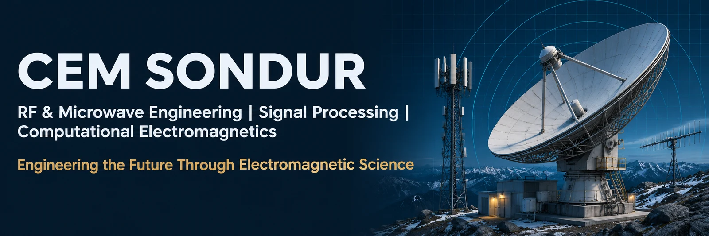
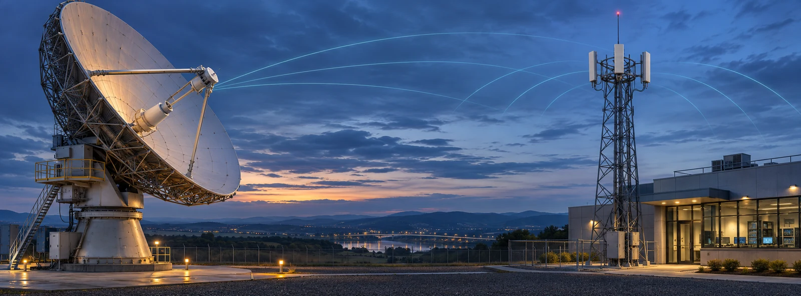

# Cem Sondur

**RF & Microwave Engineering · Signal Processing · Computational Electromagnetics**

[Personal website](https://csondurr.github.io) · [LinkedIn](https://www.linkedin.com/in/cem-sondur-a8376225b/) · [Research repositories](https://github.com/csondurr?tab=repositories)

My academic background is in Electrical and Electronics Engineering at Adana Alparslan Türkeş Science and Technology University, where the program is taught in English. I study how electromagnetic fields interact with structures and how signal processing can recover information from the resulting measurements.

My work spans broadband antenna design, microwave propagation and sensing, software-defined radio, and embedded signal analysis. I use full-wave and multiphysics simulation to examine physical designs, then build computational models or firmware to evaluate how they could work within a complete system. My long-term goal is to pursue original research in electromagnetic sensing and intelligent wireless systems.

## Vision

Contribute to electromagnetic science and intelligent communication systems by developing original sensing and wireless technologies whose operating limits can be characterized and verified.

## Mission

Turn physical hypotheses into engineering designs through mathematical modeling, electromagnetic simulation, and signal-processing development. Publish the assumptions, models, and verification methods so others can reproduce the results and carry promising designs into prototype testing.

## Research Domains

- **RF & Microwave Engineering** · Passive components, feed transitions, propagation, and microwave sensing.
- **Antenna Systems & Electromagnetics** · Broadband directional antennas, full-wave simulation, and computational scattering models.
- **Radar, Sensing & Wireless Communications** · Radar signatures, passive electromagnetic sensing, non-line-of-sight links, and electronic warfare research.
- **Digital Signal Processing & SDR** · Complex IQ modeling, receiver impairments, and fixed-point implementation.
- **Embedded Engineering Systems** · STM32 firmware, conditioned RF data acquisition, and onboard anomaly detection.
- **AI-Assisted Engineering Research** · Machine learning for inverse RF problems and parameter estimation from simulated responses.

## Advanced Radar & Wireless Communication Systems

*Concept illustration of a radar and wireless research site.*

## Featured Projects

### RF propagation, radar & antenna systems

**[PASSBRIDGE](https://github.com/csondurr/PASSBRIDGE)** · *Wireless propagation · Numerical feasibility study*\
Evaluates a passive 5.5 GHz reflector for an obstructed link. Combines CST scattering models, COMSOL structural analysis, and MATLAB QPSK-OFDM simulations to examine how wind loading and pointing error affect the link.

**[MORPHEUS](https://github.com/csondurr/MORPHEUS)** · *Computational electromagnetics · Numerical study*\
Models a programmable active Huygens shell in MATLAB and evaluates whether its synthesized response can reproduce a target scattering signature across a defined frequency, angle, and polarization basis.

**[wideband-lpda-antenna](https://github.com/csondurr/wideband-lpda-antenna)** · *Antenna engineering · Full-wave simulation*\
Designs and simulates a 2.4–5.8 GHz air-dielectric twin-boom log-periodic dipole array in CST, with documented input matching and directional radiation behavior.

**[wideband-vivaldi-antenna-balun](https://github.com/csondurr/wideband-vivaldi-antenna-balun)** · *RF front-end design · Simulation and PCB fabrication files*\
Pairs a 2–6 GHz balanced tapered-slot antenna with a broadband transition from a 50 Ω single-ended port to a 100 Ω differential feed. Includes CST models and PCB manufacturing outputs.

### Signal processing, embedded systems & inverse modeling

**[GENESIS-DSP](https://github.com/csondurr/GENESIS-DSP)** · *Digital signal processing · Software research prototype*\
Generates impairment-aware IQ data, searches candidate receiver pipelines, and tests their behavior before fixed-point conversion and code export.

**[Spectra-STM32](https://github.com/csondurr/Spectra-STM32)** · *Embedded sensing · Firmware build verified, hardware validation pending*\
Implements adaptive baseline learning, anomaly classification, and event logging on STM32H743 using conditioned analog signals from an external RF front end.

**[Dielectric-resonator-sensor-with-CSRR](https://github.com/csondurr/Dielectric-resonator-sensor-with-CSRR)** · *Microwave sensing · Simulation-based proof of concept*\
Automates CST sweeps and uses MATLAB regression to estimate effective relative permittivity from resonance features in simulated transmission traces.

**[RF-AI-SYNTHESIZER](https://github.com/csondurr/RF-AI-SYNTHESIZER)** · *Machine learning for RF · Synthetic-data prototype*\
Trains a one-dimensional convolutional network in MATLAB to recover a simulated bandpass filter’s center frequency and bandwidth from noisy magnitude and phase responses.

## Engineering Toolkit

- **Electromagnetic and circuit modeling** · CST Studio Suite, COMSOL Multiphysics, Keysight ADS
- **Scientific computing and SDR** · MATLAB, Python, NumPy, GNU Radio
- **Hardware and firmware** · KiCad, STM32

## Research Philosophy

I start with a mathematical model and make its assumptions explicit. I use simulation to test sensitivity and identify the conditions under which a result holds. When measurements are available, I compare them with predictions and document the test setup, calibration, and sources of uncertainty. I keep models, code, and data-processing steps traceable so the work can be scrutinized, reproduced, and improved as evidence accumulates.

## Contact

[GitHub](https://github.com/csondurr) · [Personal website](https://csondurr.github.io) · [LinkedIn](https://www.linkedin.com/in/cem-sondur-a8376225b/)
